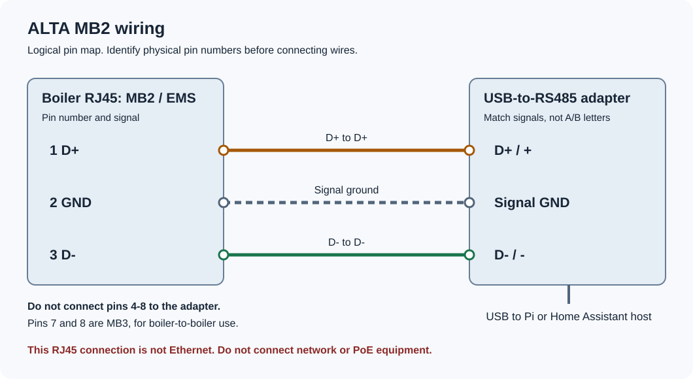

# Burnham ALTA for Home Assistant

Monitor your ALTA boiler's temperatures, heat demand, pumps, burner activity and fault codes in Home Assistant. The integration reads data over Modbus. It does not control the boiler or change its settings.

Tested with an ALTA120B1G00, Home Assistant 2026.10.1 and a Raspberry Pi USB-to-RS485 gateway. Other ALTA models and firmware may differ.

## Wire the boiler

The ALTA's RJ45 connection carries RS485. It is not an Ethernet port. MB2 uses three wires:

| Boiler RJ45 pin | Connect to the RS485 adapter |
| --- | --- |
| 1: D+ | D+ / + |
| 2: GND | Signal GND |
| 3: D- | D- / - |

[Read the wiring guide](docs/wiring.md) before connecting anything. It covers cable colors, adapter labels and the pins you must leave disconnected. Internal work should be done by a qualified installer with boiler power isolated.

You can attach the adapter directly to your Home Assistant host, or use a Raspberry Pi as a [Modbus TCP gateway](docs/gateway.md).

## Install

1. In HACS, open **Custom repositories** and add `https://github.com/aserper/boiler-pi` as an Integration.
2. Download **Burnham ALTA** and restart Home Assistant.
3. Open **Settings > Devices & services > Add integration** and choose **Burnham ALTA**.
4. Choose a connection:
   - **Modbus TCP:** enter your gateway's address and port. The Pi setup in this guide uses port `1502` and unit ID `1`.
   - **Serial RTU:** enter the adapter's device path on the Home Assistant host. Prefer `/dev/serial/by-id/...` over `/dev/ttyUSB0`.

The serial defaults are `38400`, `8-N-1`, unit ID `1`. The gateway must translate Modbus TCP to RTU. A raw TCP serial bridge will not work with this integration's TCP mode.

## Configure

Open the integration's **Configure** screen to change:

- Polling interval: 10 seconds by default, adjustable from 5 to 3600 seconds.
- CH1, CH2 and DHW names: use names such as "Upstairs", "Main floor" and "Hot water" after checking which heating circuit each input represents.

These names change display labels only. Your existing entity IDs and boiler settings stay the same. If you have also renamed an entity in Home Assistant, that name takes precedence. Clear the entity-name override to use the name from Configure.

## Dashboard

The [styled dashboard](docs/dashboard-styled.json) shows temperatures, demand, pump status, diagnostics, counters and recorded temperature history. It needs button-card, card-mod and apexcharts-card from HACS. [Dashboard setup](docs/dashboard-notes.md) explains how to connect it to your entities. A [simpler native-card version](docs/dashboard-ready.yaml) is also available.

The integration exposes 23 sensors. Missing temperature readings show as unavailable. State names on the styled dashboard follow the ALTA manual; raw codes remain available on the entities. See the [register notes](docs/registers.md) for addresses and the few values that still need confirmation.

## If readings stop

- Check that the USB adapter is still present and the gateway service is running.
- Check the Pi's power supply. Undervoltage can make USB and network connections unreliable.
- Check the unit ID and serial settings. Only one program should own the serial port.
- For a container-based Home Assistant install, make sure the serial device is passed through to the container.

Modbus TCP has no login or encryption. Keep it off the internet and restrict gateway access. A gateway that allows only function 03 adds protection against writes from other clients. Boiler fault handling and safety limits remain the boiler's job.
