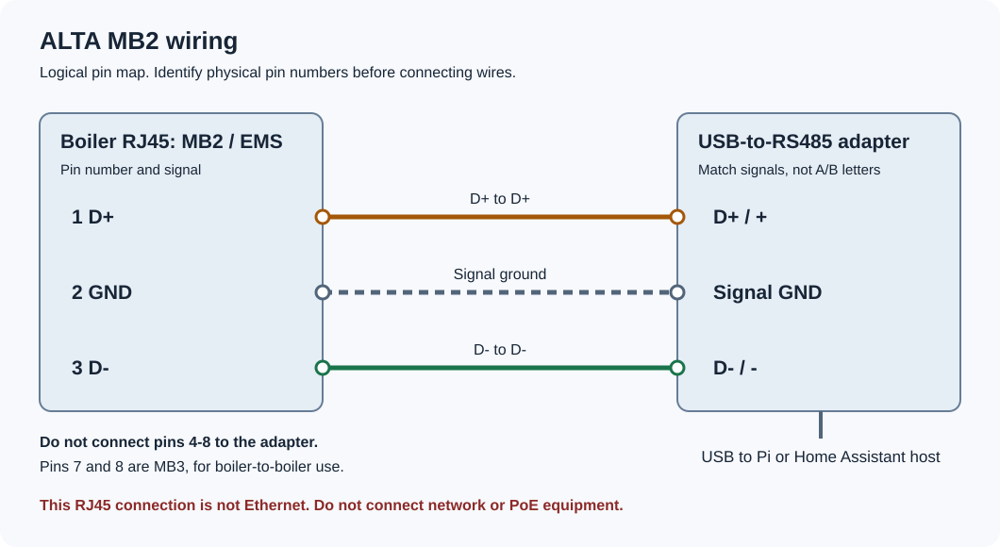

# Wiring the ALTA's Modbus connection

The ALTA uses an RJ45 connector for its RS485 interfaces. Do not plug it into a router, switch, PoE injector or Ethernet adapter.

Boilers contain mains voltage. Have a qualified installer make internal connections with boiler power isolated. Check the instructions for your exact boiler and control revision before wiring.

## What you need

- A USB-to-RS485 adapter that supports two-wire, half-duplex RS485 and has a signal-ground terminal. An isolated adapter is preferable. A USB-to-TTL UART adapter is not suitable.
- A Cat5e cable with a known pinout, or an RJ45 breakout with numbered terminals.
- A continuity tester to check which conductor reaches each RJ45 pin.

## Connect MB2

The drawing is a logical pin map, not a front or rear view of the connector. Use the connector manufacturer's pin numbering or a numbered breakout. Check each conductor with a continuity tester while the cable is disconnected from the boiler and adapter.

| RJ45 pin | ALTA signal | Adapter terminal | T568B conductor | T568A conductor |
| --- | --- | --- | --- | --- |
| 1 | D+ (A) | D+ / + | Orange/white striped | Green/white striped |
| 2 | GND (C) | Signal GND | Solid orange | Solid green |
| 3 | D- (B) | D- / - | Green/white striped | Orange/white striped |

Pin numbers take priority over colors. Cables and breakouts may be wired differently, and some adapter makers reverse the meanings of A and B. Confirm which adapter terminal is D+ and which is D- from its documentation. Do not match the letters A and B alone.

Connect pin 2 to the adapter's signal ground, not a mains or protective-earth terminal. Insulate unused conductors so they cannot touch the control board.

Leave these pins disconnected from the adapter:

- Pins 4, 5 and 6 are unused in the manual's MB2 pinout.
- Pins 7 and 8 belong to MB3, the boiler-to-boiler interface. Do not use them for this connection.

Before restoring power, check for reversed conductors, loose strands and shorts. Do not guess at termination or bias resistors; follow the boiler and adapter instructions for the actual bus.

## Serial settings

| Setting | Value |
| --- | --- |
| Protocol | Modbus RTU |
| Baud rate | 38400 |
| Data bits | 8 |
| Parity | None |
| Stop bits | 1 |
| Unit ID | 1 by default |
| Function | 03, read holding registers |

The ALTA manual specifies 38400 baud, no parity and RTU, but does not give a stop-bit count. `8-N-1` worked with the tested boiler. The unit ID can differ if someone changed it during installation.

Connect the adapter's USB cable to your Home Assistant host for direct serial use. For remote access, connect it to the Pi and configure a [Modbus TCP gateway](gateway.md). Do not run a serial probe alongside a gateway that already owns the port.

## Source

[ALTA Extended Features Instructions, 112401-01, October 2023](https://www.afsupply.com/pub/media/catalog/product/matridtech/burnham/manual/ALTA1201G02_2.pdf), section 4, tables 4-1 and 4-2. The pin table above follows that document. Recheck it against the manual supplied with your boiler.
